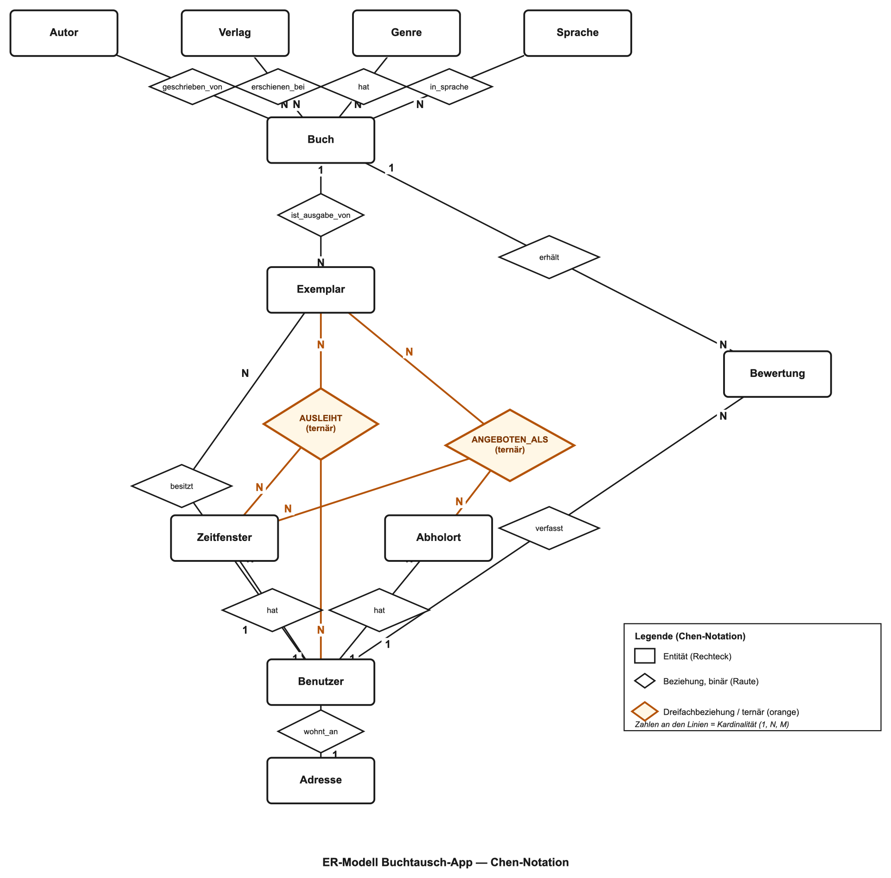

# Data-Mart-Erstellung in SQL (DLBDSPBDM01_D): Konzeptionsphase

**Miskovic, Dominik · Matrikelnummer: 14133980 · Kurs: DLBDSPBDM01_D**

## 1. Problembeschreibung und Lösungsansatz

Viele Menschen besitzen Bücher, die sie aktuell nicht lesen, aber nicht endgültig weggeben möchten, während andere in der Nachbarschaft genau diese Bücher gerne lesen würden, ohne sie dauerhaft zu besitzen. Die **Buchtausch-App** löst dieses Problem, indem sie Buchbesitzende und Interessierte in einer lokalen Gemeinschaft zusammenbringt und den zeitlich befristeten Verleih organisiert.

Die Datenbank wird als relationales Schema mit **PostgreSQL** umgesetzt: ein modernes, quelloffenes DBMS mit vollständiger SQL-Unterstützung, das über die Erweiterung PostGIS zusätzlich effiziente räumliche Abfragen (Umkreissuche über Geokoordinaten) ermöglicht, was für die geforderte Kartenansicht zentral ist. Das Datenmodell trennt konsequent zwischen der **Buchausgabe** (unveränderliche bibliografische Daten wie Titel, Autor:in, Verlag, Genre, Sprache) und dem **Exemplar** (die konkrete, ausleihbare Kopie einer Person mit individuellem Zustand, Verleihbedingungen und Standort). Diese Trennung vermeidet redundante Datenspeicherung und bildet die Grundlage für eine angemessene Normalisierung (3NF).

## 2. Anforderungsspezifikation

### 2.1 Rollen

Jede registrierte **Benutzer:in** kann gleichzeitig als **Verleiher:in** (Besitzer:in eines eingestellten Exemplars) und als **Entleiher:in** (Ausleihende:r eines fremden Exemplars) auftreten. Funktional ist das eine Rolle mit zwei kontextabhängigen Aktionsbereichen, nicht zwei getrennte Rollen.

### 2.2 Aktionen

**Verleiher:in:** Profil (Name, Adresse, Kontakt) pflegen · Buch als Exemplar einstellen (Zustand, max. Leihdauer, Versandoption) · Abholorte definieren · Verfügbarkeitszeitfenster festlegen · Exemplar mit Ort/Zeitfenster-Kombination aktiv anbieten · Ausleihvorgänge einsehen, Rückgabe bestätigen.

**Entleiher:in:** Bücher tabellarisch durchsuchen/filtern (Genre, Sprache, Zustand) · verfügbare Bücher auf einer Karte im Umkreis anzeigen · Exemplar zu einem Zeitfenster ausleihen · Buch zurückgeben · nach Rückgabe bewerten und kommentieren.

### 2.3 Daten und Funktionen

**Daten:** bibliografische Daten je Buchausgabe (Titel, ISBN, Erscheinungsjahr, Genre, Verlag, Sprache, Autor:in) · Personendaten (Name, Adresse, Kontakt) · Exemplardaten (Zustand, Leihdauer, Versand, Besitzer:in) · Logistikdaten (Abholorte mit Geokoordinaten, Zeitfenster) · Transaktionsdaten (Ausleih-/Rückgabedatum, Status) · Bewertungsdaten (Sterne, Kommentar).

**Funktionen:** tabellarische Suche/Filterung · räumliche Umkreissuche über Geokoordinaten · Verwaltung von Ausleihvorgängen · Erfassen/Anzeigen von Bewertungen.

## 3. Entity-Relationship-Modell

Das Modell umfasst **11 Entitäten** und wird in **Chen-Notation** dargestellt (Rechteck = Entität, Raute = Beziehung). Zwei Beziehungen sind echte **Dreifachbeziehungen** (orange hervorgehoben):

- **AUSLEIHT** (Exemplar × Benutzer × Zeitfenster, N:N:N): Da das Zeitfenster der besitzenden Person zugeordnet ist, bestimmt kein Paar der drei Entitäten das dritte Element eindeutig. *Bewusst vermieden wurde die naheliegende Triade „Verleiher:in, Entleiher:in, Exemplar" aus der Aufgabenstellung, da die verleihende Person bereits über `Exemplar.besitzer_id` feststeht. Dies wäre eine unechte, auf eine binäre Beziehung reduzierbare Ternärbeziehung.*
- **ANGEBOTEN_ALS** (Exemplar × Abholort × Zeitfenster, N:N:N): Eine besitzende Person kann pro Exemplar eine individuelle, gültige Kombination aus Ort und Zeitfenster festlegen.

## 4. Datenwörterbuch (kompakt)

| Entität | Schlüsselattribute (Auswahl) |
|---|---|
| Benutzer | benutzer_id (PK), vorname, nachname, email (UNIQUE), telefon, registrierdatum |
| Adresse | adresse_id (PK), benutzer_id (FK), strasse, plz, stadt, breitengrad, laengengrad |
| Buch | buch_id (PK), titel, isbn, erscheinungsjahr, genre_id (FK), verlag_id (FK), sprache_id (FK) |
| Autor | autor_id (PK), vorname, nachname |
| Verlag | verlag_id (PK), name, land |
| Genre | genre_id (PK), bezeichnung |
| Sprache | sprache_id (PK), bezeichnung, iso_code |
| Exemplar | exemplar_id (PK), buch_id (FK), besitzer_id (FK), zustand, versand_moeglich, max_leihdauer_tage |
| Abholort | abholort_id (PK), benutzer_id (FK), bezeichnung, breitengrad, laengengrad |
| Zeitfenster | zeitfenster_id (PK), benutzer_id (FK), wochentag, startzeit, endzeit |
| Bewertung | bewertung_id (PK), buch_id (FK), benutzer_id (FK), sternebewertung (1–5), kommentar |

*(vollständiges Datenwörterbuch mit allen Attributen und Datentypen: siehe `02_Datenwoerterbuch.md`)*

### Beziehungsübersicht (Kardinalitäten, Chen-Notation)

| Beziehung | Kardinalität |
|---|---|
| Benutzer–Adresse, Benutzer–Exemplar, Benutzer–Abholort, Benutzer–Zeitfenster, Benutzer–Bewertung | 1:1, 1:N, 1:N, 1:N, 1:N |
| Exemplar–Buch, Buch–Genre, Buch–Verlag, Buch–Sprache | N:1 |
| Buch–Autor | N:M |
| Buch–Bewertung | 1:N |
| **AUSLEIHT** (Exemplar, Benutzer, Zeitfenster) | N:N:N |
| **ANGEBOTEN_ALS** (Exemplar, Abholort, Zeitfenster) | N:N:N |

---
*Umfang: Anforderungsspezifikation max. 2 Seiten, Gesamtdokument max. 4 Seiten, 11pt (gemäß Aufgabenstellung Kap. 1.1).*
